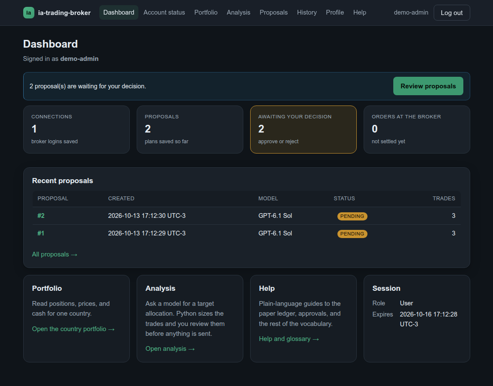
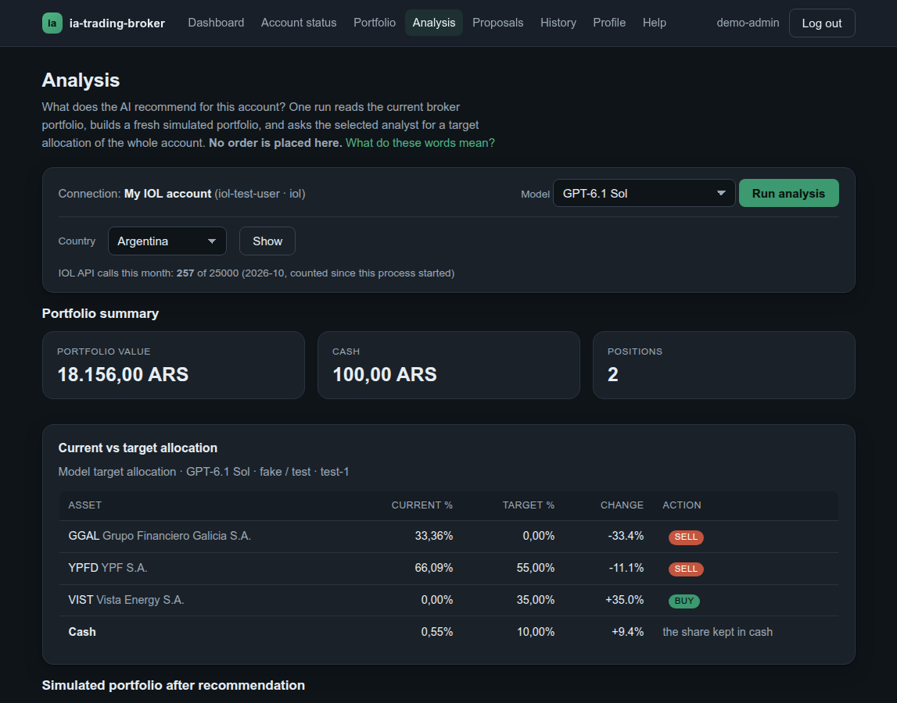
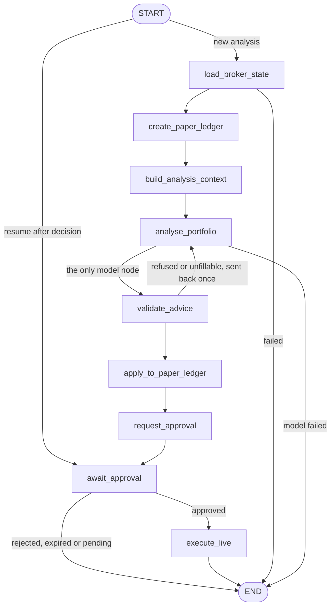
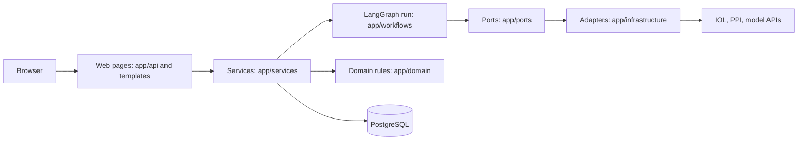

# ia-trading-broker

An independent, experimental portfolio assistant for broker accounts. It reads
your portfolio, asks an AI model how to allocate the money you already have,
turns that answer into exact trades in Python, and stops so **you** can review
and approve them. It is a reviewed rebalance, not a trading bot.

- The model only suggests target weights. It never sees or sends an order.
- Python validates the answer and sizes every trade (whole units, sells before buys, cash and position limits).
- Nothing reaches the broker without your approval, and each trade is executed on your command.
- **InvertirOnline (IOL)** is the primary integration. The architecture is broker-independent: a **paper account** lets you try plans with no real money, and a PPI connection can be saved and read for cash and prices (it cannot be analysed or traded yet).

> **Disclaimer.** This is an independent experimental trading application. It is
> not affiliated with, sponsored by, or endorsed by InvertirOnline (IOL), PPI or
> any model provider. Product and company names are trademarks of their
> respective owners.
>
> The software uses publicly documented broker APIs. You are responsible for
> having the right to use them and for complying with your broker's terms and
> conditions. This repository does not include any broker's documentation, data
> or logos.
>
> It is **not financial or investment advice**. Trading involves financial
> risk, including loss of capital. Models can be wrong and the software can
> have bugs. **Live order execution is experimental, has not been validated end
> to end, and must not be considered production-ready.** You alone are
> responsible for what you approve and execute and for keeping your credentials
> and API keys safe. The software is provided as is, without warranty or
> liability.
>
> Your portfolio and derived price indicators are sent to the model provider you
> choose for each analysis.

**Links:** [Roadmap](docs/roadmap.md) · [Architecture](docs/architecture.md) ·
[Operations and smoke test](docs/operations.md) · API reference (Swagger UI) at
<http://localhost:8000/docs> when the app runs.

## Project status

| Status | What |
|---|---|
| **Implemented** (covered by offline tests with fake brokers and a fake model) | IOL login, portfolio, account status and daily price history reads · one-call AI allocation through a model catalog (OpenAI, Gemini, MiMo, Grok, DeepSeek, Claude) · deterministic validation and rebalance (whole units, sells first, cash floor, position caps, bond quotation factors, "not executable" reasons) · paper ledger preview · single-use human approval that expires · per-trade execution capped at the reviewed quantity, sales before purchases, idempotent order rows · on-demand reconciliation · event history · a broker-reader port with IOL, PPI and paper adapters · per-broker encrypted credentials with a form that follows the chosen broker · paper accounts (their own saved state, priced through a real connection, with a reset) · currency on money amounts · error and trace redaction · optional LangSmith tracing |
| **Experimental / not validated** | **Live IOL order execution**: submission reached IOL in the author's manual tests, but fills, partial fills, rejections and restarts have not all been validated against the real broker end to end · Claude through the Anthropic SDK and DeepSeek JSON mode have not been exercised against the live APIs · PPI (login, cash and prices tested only against a mock; PPI's published schema has no holdings list, so a PPI account cannot be analysed, and no PPI order can be sent) |
| **Planned** | A PPI portfolio reader and PPI orders · ARS and USD through the ledger and rebalance · per-strategy allocation bands · running several models side by side · scheduled reconciliation, Orders and Activity pages · performance tracking · deployment automation · Interactive Brokers. Details in the [roadmap](docs/roadmap.md) |

**Current limitations:** one currency per ledger (no USD cash); daily data only;
reconciliation runs when you press a button, and an order that never got an
operation number must be checked in your broker account; tables are created at
startup with no migrations; designed for a single trusted operator, not as a
multi-user service; not hardened or reviewed for production use.

## Screens

<table>
  <tr>
    <td width="50%" valign="top">
      <a href="screens/screen1.png"></a>
      <br><sub><b>Dashboard.</b> Where the account stands and the next thing to do: proposals waiting for a decision, orders still open at the broker, and the latest plans.</sub>
    </td>
    <td width="50%" valign="top">
      <a href="screens/screen2.png"></a>
      <br><sub><b>Analysis.</b> Pick a model, run it, and compare the current allocation with the model's target before any trade exists.</sub>
    </td>
  </tr>
</table>

## How it works

1. **Read** the current portfolio and daily prices from the broker.
2. **Ask** one model for a target allocation of the whole account. If its answer is refused or cannot be turned into trades, it is sent back once with the reasons.
3. **Validate and size** in Python, and apply the trades to a paper ledger.
4. **Review** the before and after portfolio on a page.
5. **Approve** or reject. Approving sends nothing by itself, and an approval expires.
6. **Execute** each trade with its button, never more than the reviewed quantity and never a purchase before the sales. Orders are saved before they are sent, so a restart never duplicates one.

The workflow is a LangGraph. PostgreSQL is the source of truth, so a restart resumes from the saved proposal.



## Stack

| Part | What we use |
|---|---|
| Language | Python 3.12 |
| Web | FastAPI with server-rendered Jinja2 pages |
| Database | PostgreSQL (async SQLAlchemy). Tests use in-memory SQLite |
| Workflow | LangGraph 1.x, optional LangSmith tracing |
| Models | OpenAI, Gemini, DeepSeek, Grok, MiMo and Claude, chosen in `config/models.toml` |
| Brokers | IOL (primary), PPI (cash and prices only), paper account (simulated) |
| Run and test | Docker Compose, pytest, ruff, GitHub Actions |

## Architecture



| Layer | Folder | Job |
|---|---|---|
| Web | `app/api/`, `templates/` | Pages and forms |
| Services | `app/services/` | Use cases: analysis, rebalance, approvals, execution, orders, events |
| Workflow | `app/workflows/` | The LangGraph run |
| Domain | `app/domain/` | Pure rules and models: money, advice, universe, orders |
| Ports | `app/ports/` | Interfaces for the model, for reading a broker, and for order execution |
| Adapters | `app/infrastructure/` | One folder per outside system: `iol/`, `ppi/`, `openai/`, `anthropic/` |
| Config | `config/` | The instrument universe and the model catalog |

A new broker or model is a new adapter behind an existing port. The rules that
never change are in [AGENTS.md](AGENTS.md). More diagrams (sequence, classes,
database) are in [docs/architecture.md](docs/architecture.md).

## Quick start

You need Docker with the Compose plugin, an IOL account, and one model API key
(or use the **Fake simulator** model, which needs no key).

```bash
# 1. Configuration
cp .env.example .env
python3 -c "import secrets; print(secrets.token_urlsafe(48))"                                # SECRET_KEY
python3 -c "import base64, os; print(base64.urlsafe_b64encode(os.urandom(32)).decode())"     # CREDENTIAL_ENCRYPTION_KEY
```

Edit `.env`: set `SECRET_KEY`, `CREDENTIAL_ENCRYPTION_KEY`, `POSTGRES_PASSWORD`,
and the key of the model you will use (for example `OPENAI_API_KEY`).
**Leave `IOL_LIVE_PLAZO` empty and `IOL_LIVE_VALIDITY_DAYS=0`** so no real order can be sent yet.

```bash
# 2. Start (app on http://localhost:8000)
docker compose up --build -d

# 3. Create your login
docker compose exec app python -m app.cli create-admin --username admin

# 4. Check it is healthy
curl -fsS http://localhost:8000/readyz
```

Open <http://localhost:8000>, sign in, add your IOL connection under **Profile**,
then **Analysis** to run one. After changing code or `config/*.toml`, run
`docker compose up --build -d app` again. After changing only `.env`, run
`docker compose up -d app`.

**Without Docker:** use Python 3.12 and a reachable PostgreSQL, set `DATABASE_URL`
in `.env`, then:

```bash
python3.12 -m venv .venv && source .venv/bin/activate
python -m pip install -r requirements-dev.txt
python -m app.cli create-admin --username admin
uvicorn app.main:app --host 127.0.0.1 --port 8000
```

**Tests** (offline: no broker, no model API, no money): `python -m pytest -q`, and
`ruff check . && ruff format --check .`. CI runs the same on every pull request.

**Upgrading an existing database** (it was created before per-broker credentials): run the two
`ALTER TABLE` statements in [docs/operations.md](docs/operations.md). A fresh database needs nothing.

## Real orders

Live orders stay blocked until you set `IOL_LIVE_PLAZO` (for example `t2`) and
`IOL_LIVE_VALIDITY_DAYS` in `.env`. Once set, pressing **Execute** on an approved
proposal sends a real order with real money. Live execution is experimental (see
the status above): try the app without these settings first, start with a very
small amount, and check every order in your broker account. The step-by-step
safe test and the live test are in [docs/operations.md](docs/operations.md).

## Configuration

Copy `.env.example` to `.env`. Secrets live only in the environment, never in Git.

| Setting | What it is |
|---|---|
| `SECRET_KEY` | Application secret |
| `CREDENTIAL_ENCRYPTION_KEY` | Encrypts saved broker passwords. Keep it with your database backups |
| `POSTGRES_PASSWORD` | Database password for Compose |
| `OPENAI_API_KEY`, `GEMINI_API_KEY`, `DEEPSEEK_API_KEY`, `XAI_API_KEY`, `MIMO_API_KEY`, `ANTHROPIC_API_KEY` | Only the key of the model you use |
| `IOL_LIVE_PLAZO`, `IOL_LIVE_VALIDITY_DAYS` | Turn live orders on. Empty keeps them off |
| `APPROVAL_EXECUTION_WINDOW_HOURS` | How long an approved plan may still be executed (default 24) |
| `ANALYSIS_MAX_ATTEMPTS` | How many answers one run may ask of the model (default 2; 1 turns the retry off) |

Which instruments and limits to use is in `config/universe.toml`; which models
appear in the dropdown is in `config/models.toml`. The full list of settings is
in [docs/operations.md](docs/operations.md).

## More

- [docs/architecture.md](docs/architecture.md): sequence, classes, database, how weights become trades, live execution rules.
- [docs/operations.md](docs/operations.md): all settings, restarts, resetting data, tracing, smoke test, working with AI assistants.
- [docs/roadmap.md](docs/roadmap.md): where the project is going and what is left.
- [AGENTS.md](AGENTS.md): the rules for anyone, human or AI, changing the code.
- `postman/`: a folder Git ignores. Keep your broker's own API collections here; they are the broker's documentation and are not shipped with this repo.

Keep `.env`, credentials and database backups out of Git. Use HTTPS before any
public deployment.
