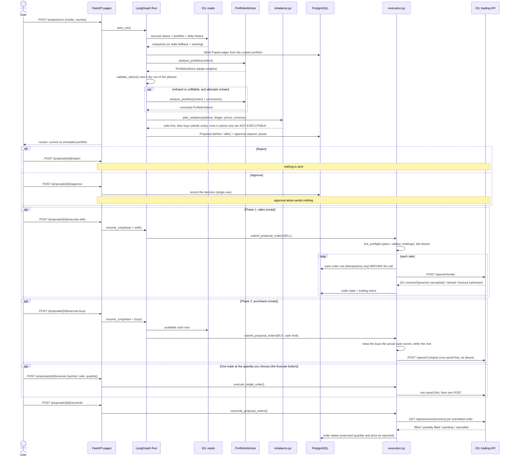
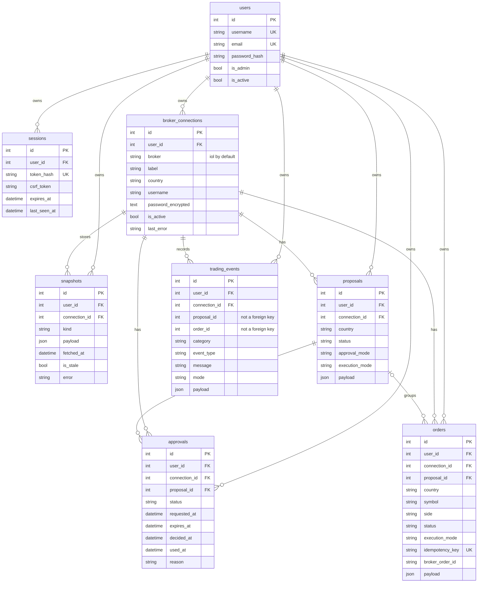

# Architecture

How the pieces fit together. For the short version and how to run the project,
see the [README](../README.md).

## Layers and ports

One FastAPI application, one PostgreSQL database, server-rendered Jinja2 pages.
Every route is listed in the Swagger UI at `/docs`; write forms require a CSRF
token and authenticated data is owner-scoped. `/analysis/run` takes a catalog
key, not an API model id.

| Location | Responsibility |
|---|---|
| `app/api/` | Pages, forms, authentication, redirects |
| `app/domain/` | Advice contracts, money, indicators, universe, plan and order models |
| `app/ports/` | `PortfolioAdvisor` and `OrderExecutor` |
| `app/services/` | Broker reads, snapshots, ledger, advice, rebalance, proposals, approvals, execution, orders, events |
| `app/workflows/` | The LangGraph above |
| `app/infrastructure/iol/` | IOL HTTP reads and writes, mapping, tokens, order executor |
| `app/infrastructure/ppi/` | PPI REST client and order executor (adapter only; see below) |
| `app/infrastructure/openai/` | Model client (Responses and Chat Completions), advisor, prompt |
| `app/infrastructure/anthropic/` | Claude client (Anthropic SDK, structured output through `output_config.format`) |
| `app/infrastructure/simulation/` | Paper order execution and the offline portfolio simulator |
| `app/tracing.py` | Optional LangSmith tracing; safe spans only |
| `config/` | Universe and model catalog |
| `templates/`, `static/` | Pages, local formatting, print export |
| `tests/` | Offline tests; the fake IOL transport lives here only |

```text
PortfolioAdvisor
├── OpenAIPortfolioAdvisor    real endpoints (api = "responses", "chat" or "anthropic")
└── FakePortfolioAdvisor      offline simulator (catalog kind = "fake")

OrderExecutor
├── PaperOrderExecutor        simulated fills
├── IOLOrderExecutor          live IOL orders (fail-closed preflight)
└── PPIOrderExecutor          Budget then Confirm; built and tested, not yet selectable

BrokerReader                   read one account: portfolio, cash, prices, an operation
├── IOLBroker                 IOL; owns the login, the token cache and the single retry
├── PPIBroker                 PPI; cash and prices only, positions fail closed
└── PaperBroker               a simulated account, priced through a real connection
```

**Choosing a broker.** A connection names its broker (`iol`, `ppi`, `paper`).
`app/domain/brokers.py` says what each one needs (its credential fields) and
what it can do. `open_reader` in `app/services/broker.py` returns the adapter,
so a service reads a portfolio or a price history without knowing whose it is.
IOL keeps its login in `username` and `password_encrypted`; every other broker
keeps all its fields in one encrypted JSON value, `credentials_encrypted`.

**Cash is read with the portfolio.** IOL's holdings endpoint does not report
cash, so a portfolio read also reads the cash balances in the same session (one
extra call) and adds only the balances in the portfolio's own currency. It is
never taken from an older saved account status: holdings and cash from different
moments add up to a portfolio that never existed. A live purchase likewise
confirms the cash with the broker right before it is sent.

**Paper accounts.** A paper account has its own saved state (the snapshot kind
`paper_account:{country}`), started from a cash amount or a copy of a real
account's holdings, and priced through one of the user's real connections. It
is kept apart from the per-run preview ledger, which every analysis rebuilds,
so an unapproved plan never changes the account. Its proposals run in `PAPER`
mode: the same review and approval, fills applied locally, and no broker
involved.

**PPI.** `app/infrastructure/ppi/` follows PPI's Postman collection and the
OpenAPI file (kept locally in `postman/`). It has the client (login, refresh,
accounts, cash, quotes, history, order detail, budget, confirm), the executor,
and `PPIBroker`. A PPI connection can be saved, tested, and read for cash and
prices. PPI's published schema has no list of holdings, so a PPI portfolio
cannot be read and a PPI account cannot be analysed yet, and no PPI order can
be sent. See the [roadmap](roadmap.md).

Python validates the allocation and owns execution. The model cannot supply
quantities, prices, or broker requests.

## End-to-end sequence

What one analysis does, from the browser to the broker, and how its trades are
then executed:



## How target weights become trades

`app/services/rebalance.py` is the only place that turns the allocation into
quantities:

- `target value = portfolio value × target weight`; the delta against the
  current value decides BUY, SELL, or HOLD;
- quantities are whole units rounded down; the rounding difference stays in
  cash. A target within 1% of the next whole unit counts as that unit, so a
  target a few cents short of one share is not refused (the cash floor, the
  position cap and the funds available still apply);
- **sells are planned and applied before buys**, so sale proceeds fund the
  buys, and execution uses the same order;
- never sell more than is held, never buy with money the ledger does not have,
  and the configured cash floor and position caps are enforced;
- the simulated operations are self-financing: the preview keeps the total
  value and assumes no new capital.

A trade the model asked for but Python cannot size — over the single-position
cap, below the minimum, unfunded, or in a category whose quantity convention is
unverified — appears in the proposal's **Not executable** table with the
required quantity, the minimum executable quantity, its estimated value, the
position limit, and the reason. It is never submitted, and the target value
stays in cash.

## Bonds: quotation factor and minimums

Stocks and CEDEARs are quoted per 1, but the sovereign bonds are quoted **per
100 nominales**. `config/universe.toml` sets `quotation_factor = 100` for the
`bonds` category, so one tradable unit costs `quoted_price / 100` and an order
moves `quoted_price * quantity / 100`. The price sent to IOL is the quoted
price, unchanged; only the sizing divides by the factor. `quantity` for a bond
is the number of **nominales**.

- `min_quantity` is the smallest quantity IOL accepts for that category. A
  trade below it is shown as **NOT EXECUTABLE**, never submitted.
- `live_quantity_confirmed` records that the meaning of IOL's `cantidad` field
  is verified for that category (`true` for bonds). While it is `false`, the
  plan marks the category's trades **NOT EXECUTABLE** and the live preflight
  blocks them again. To verify a new category, set it (and `min_quantity` if
  the broker enforces one) in `[universe.<category>]`.

## Live execution

`app/services/execution.py` is the only caller of an `OrderExecutor`.
`PaperOrderExecutor` covers paper-mode proposals;
`app/infrastructure/iol/order_executor.py::IOLOrderExecutor` sends the real
ones. Nothing is sent by approval alone.

- **One trade (the review page):** every trade has its own **Execute** button
  with a quantity prefilled with the plan's suggestion and editable.
- **Phases (routes, no button yet):** `POST /proposals/{id}/execute-sells`
  submits the remaining sales; `execute-buys` submits the purchases the cash
  IOL actually reports can pay for; `resume` reconciles first, then continues
  until the plan is submitted. Proceeds of a sale that has not settled fund
  nothing; a buy the cash cannot cover is deferred and reported.

Rules that hold for every trade:

- limit orders only (`tipoOrden=precioLimite`, `cantidad`+`precio`, never
  `monto`), stocks and bonds alike;
- `plazo` and `validez` come from explicit configuration
  (`IOL_LIVE_PLAZO`, `IOL_LIVE_VALIDITY_DAYS`); live execution fails closed
  when they are missing rather than guessing a trading parameter;
- HTTP 201 + `numeroOperacion` is recorded as **accepted** (created at the
  broker, not yet a fill); 202/`ok:false` and 4xx are rejected; a timeout, a
  transport failure, or a 5xx is **unknown** and is never resent;
- the order row is saved before any POST, keyed
  `proposal:{id}:{side}:{symbol}`, so a restart or a repeated click cannot
  duplicate a live order. A trade whose order was a proven failure (rejected or
  cancelled) may be retried; the key then appends `:retryN`. An order the
  broker may still act on, or whose outcome is unknown, is never resent;
- a live result never touches the paper ledger. The broker portfolio is
  refreshed on the next analysis;
- an approval is only good for `APPROVAL_EXECUTION_WINDOW_HOURS` (24 by default),
  because the plan's prices are from the moment it was made. After that nothing
  is sent from it, including a retry, and a new analysis is needed;
- a single trade can never be sent for more units than the reviewed plan lists;
- no purchase is sent until every sale in the plan has an order that is not a
  proven failure, in the per-trade path and in the phase routes alike;
- two requests racing for the same order reach the unique idempotency key in the
  database, and the loser treats the order as already existing.

**Reconciliation.** `GET /api/v2/operaciones/{numero}` reports what actually
happened. **Refresh Order Status** re-reads every submitted order: filled,
partially filled, pending, cancelled, and rejected states are recorded with the
broker's executed quantity and execution price. A partial fill is never shown
as a complete fill, and the requested limit price is never presented as an
execution price. It runs on demand; a scheduled job is on the roadmap. An order
that never got an operation number (a timeout) cannot be looked up: it is
counted as unresolved, stays blocked from being sent again, and has to be
checked in your broker account.

There is no code path from the model to the broker without a recorded human
approval. Nothing approves automatically.

## Class diagram

The domain contracts, the two ports with their adapters, and the services in
between:

```mermaid
classDiagram
    class PortfolioAnalysisContext {
        +country
        +analysed_at
        +portfolio
        +evidence
        +watchlist
        +constraints
        +warnings
    }
    class PortfolioAdvice {
        +summary
        +target_cash_weight
        +decisions
        +model_provider
        +model_name
        +analysis_version
    }
    class AssetAdvice {
        +symbol
        +action
        +target_weight
        +confidence
        +rationale
        +risks
    }
    class PortfolioAdviceView {
        +summary
        +current_cash_weight
        +target_cash_weight
        +model_label
        +decisions
    }
    class AnalysisModel {
        +key
        +label
        +model
        +provider
        +kind
        +api
        +response_format
        +timeout_seconds
    }
    class UniverseConfig {
        +instruments
        +constraints
        +quotation_factor_for(symbol)
        +min_quantity_for(symbol)
        +live_quantity_confirmed_for(symbol)
    }
    class Instrument {
        +symbol
        +category
        +market
        +quotation_factor
        +min_quantity
        +live_quantity_confirmed
    }
    class PaperLedger {
        +country
        +currency
        +cash
        +positions
        +total_value
    }
    class PaperPosition {
        +symbol
        +quantity
        +average_price
        +last_price
        +market
        +quotation_factor
    }
    class RebalancePlan {
        +rows
        +trades()
        +not_executable()
        +ledger_before
        +ledger_after
        +warnings
    }
    class RebalanceRow {
        +symbol
        +side
        +quantity
        +price
        +notional
        +target_weight
        +executable
        +reason
    }
    class Proposal {
        +model_key
        +advice
        +ledger_before
        +ledger_after
        +recommendations
        +warnings
        +orders()
    }
    class Recommendation {
        +symbol
        +action
        +quantity
        +limit_price
        +notional
        +market
        +executable
        +reason
    }
    class Order {
        +symbol
        +side
        +quantity
        +limit_price
        +quotation_factor
        +status
        +external_id
        +broker_order_id
    }
    class OrderResult {
        +status
        +accepted
        +broker_order_id
        +message
    }
    class PortfolioAdvisor {
        <<interface>>
        +analyze(context) PortfolioAdvice
    }
    class BrokerReader {
        <<interface>>
        +authenticate()
        +get_portfolio(country) Portfolio
        +get_balances() CashBalance[]
        +get_history(symbol, market, days) PriceBar[]
        +get_operation(id)
    }
    class IOLBroker
    class PPIBroker
    class PaperBroker
    class OrderExecutor {
        <<interface>>
        +submit(order) OrderResult
    }
    class ExecutionService {
        <<module>>
        +live_preflight()
        +submit_proposal_orders()
        +execute_single_order()
        +reconcile_proposal_orders()
    }
    class OpenAIPortfolioAdvisor
    class FakePortfolioAdvisor
    class OpenAIClient
    class AnthropicClient
    class PaperOrderExecutor
    class IOLOrderExecutor
    class IOLClient
    class PPIOrderExecutor
    class PPIClient
    class Run {
        +load_broker_state()
        +create_paper_ledger()
        +build_analysis_context()
        +analyse_portfolio()
        +validate_advice()
        +apply_to_paper_ledger()
        +request_approval()
        +await_approval()
        +execute_live()
    }

    PortfolioAdvisor <|.. OpenAIPortfolioAdvisor : real endpoints
    PortfolioAdvisor <|.. FakePortfolioAdvisor : offline simulator
    OpenAIPortfolioAdvisor --> OpenAIClient : responses or chat
    OpenAIPortfolioAdvisor --> AnthropicClient : api = anthropic
    OpenAIPortfolioAdvisor --> AnalysisModel : catalog entry
    FakePortfolioAdvisor --> AnalysisModel : catalog entry
    BrokerReader <|.. IOLBroker : IOL
    BrokerReader <|.. PPIBroker : cash and prices
    BrokerReader <|.. PaperBroker : simulated account
    PaperBroker --> BrokerReader : prices from a real connection
    IOLBroker --> IOLClient
    PPIBroker --> PPIClient
    OrderExecutor <|.. PaperOrderExecutor : simulated fills
    OrderExecutor <|.. IOLOrderExecutor : live IOL orders
    OrderExecutor <|.. PPIOrderExecutor : not yet wired
    IOLOrderExecutor --> IOLClient
    PPIOrderExecutor --> PPIClient
    PortfolioAnalysisContext --> PortfolioAdvisor : analyze()
    PortfolioAdvisor --> PortfolioAdvice : one whole-portfolio answer
    PortfolioAdvice *-- AssetAdvice
    PortfolioAdviceView *-- AssetAdvice
    UniverseConfig *-- Instrument
    PaperLedger *-- PaperPosition
    RebalancePlan *-- RebalanceRow
    RebalancePlan ..> UniverseConfig : sizing rules
    Proposal *-- PortfolioAdviceView
    Proposal *-- PaperLedger : before / after
    Proposal *-- Recommendation
    Recommendation --> Order : order_from_recommendation()
    OrderExecutor --> OrderResult : submit()
    ExecutionService --> OrderExecutor : the only caller
    Run --> PortfolioAdvisor : the one AI call
    Run --> RebalancePlan : plan_rebalance()
    Run --> ExecutionService : execute_live
```



`app/domain/analysis.py` owns the advice contracts, `app/domain/trading.py` the
plan and order models, `app/domain/universe.py` the instruments and their
quotation rules, `app/ports/` the two protocols, and `app/services/` the
orchestration between them. The `Run` class in
`app/workflows/trading_flow.py` holds the graph's nodes for one connection and
country.

## Database



`snapshots.payload` holds profile, account, portfolio, price history, and the
paper ledger. `proposals.payload` holds the immutable plan: the model's target
allocation and the model key, the exact trades, and the paper portfolio before
and after. `orders.payload` holds the order and fill details; `broker_order_id`
records the broker's operation number, and `idempotency_key` is what makes a
resubmit safe. Missing tables are created on startup; existing tables are not
migrated, so a column added to an existing table needs a documented
`ALTER TABLE`.
