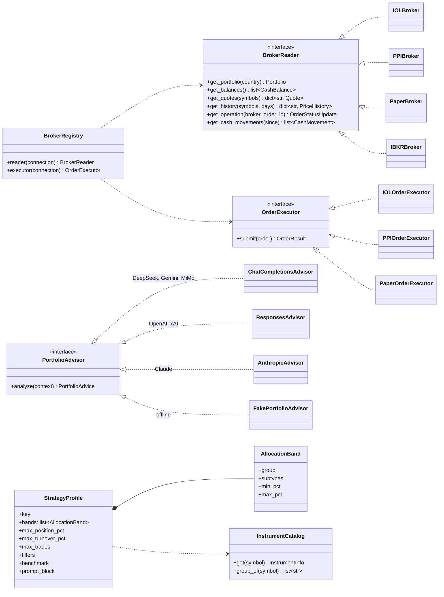
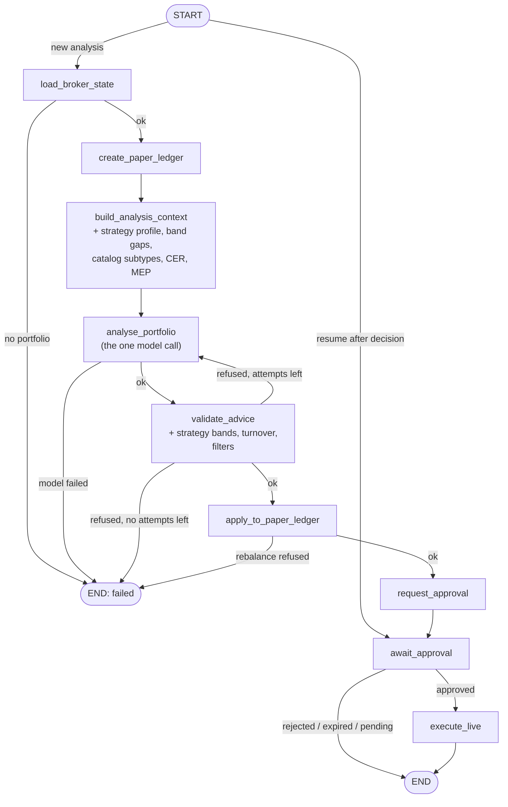
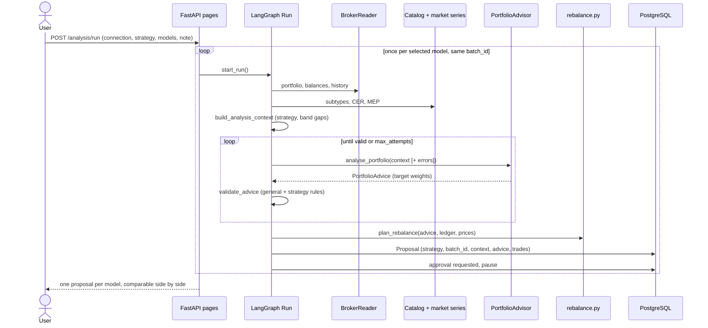
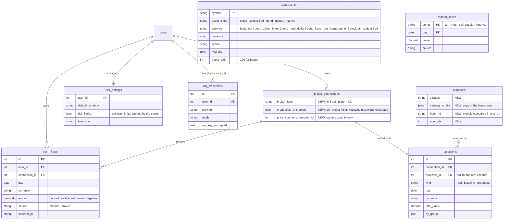

# Roadmap and target architecture

This document is the plan for growing the current MVP (IOL, one currency, one
model call per run) into a multi-broker, multi-user, multi-strategy portfolio
assistant. It keeps the existing design and adds to it. Each phase ends with
the app working, the test suite green, and an acceptance check.

> Design document, not investment advice. Strategy bands and limits below are
> starting points to be reviewed by someone with financial judgment before
> other people use them.

## 1. What does not change

These invariants hold in every phase. A change that breaks one is wrong even
if its tests pass.

1. **One model-calling node per run.** `analyse_portfolio` is the only node
   that talks to a model. The whole account goes in and one target allocation
   comes out; a refused or unfillable answer is sent back with the reasons, at
   most `ANALYSIS_MAX_ATTEMPTS` (default 2) answers in all.
2. **The model advises, Python decides.** The model returns target weights,
   reasons and risks. It never supplies quantities, prices or broker requests.
   `services/rebalance.py` is the only place that turns weights into trades.
3. **Nothing reaches a broker without a recorded human approval.**
4. **Order safety.** The order row is saved before the broker is called, keyed
   for idempotency. A timeout or 5xx is `unknown` and is reconciled, never
   resent. Sells are submitted before buys.
5. **Owner scoping.** Every query is filtered by the user from the session. A
   resource owned by another user is not found.
6. **Everything is recorded.** Every state change writes a `trading_events`
   row. Secrets never reach events, traces or logs.
7. **Tests are offline.** Fake broker transports, the fake advisor, no network.

## 2. Decisions

| Decision | Status | Choice |
|---|---|---|
| First broker to add | Decided | **PPI** first (its REST API, API-key auth), then IBKR |
| Approving executes | Decided | Approval records the decision and sends nothing. Each trade is then executed on the user's command (its **Execute** button, or the `execute-sells` / `execute-buys` / `resume` routes). `LIVE_TRADING_ENABLED` is removed; the fail-closed checks on `IOL_LIVE_PLAZO` and `IOL_LIVE_VALIDITY_DAYS` stay |
| Paper accounts | Decided | Users can create paper accounts to try proposals with the same approval flow and no real money |
| Model providers | Decided | OpenAI, Claude, Gemini, DeepSeek, Grok and Xiaomi MiMo |
| Simulation types | Decided | Five strategies (section 5) |
| Approval scope | **Open** | Today a whole proposal is approved at once. Per-action approval is more flexible, but buys depend on sells for cash. Recommendation: keep whole-proposal approval, add "approve a subset" later if needed |
| Where model API keys live | **Open** | Today: server-wide keys in `.env`. Alternative: per-user keys, encrypted like broker passwords. Recommendation: per-user keys if users pay for their own models; otherwise keep server keys |

## 3. Keep, fix, remove, add

| | What | Where |
|---|---|---|
| **Keep** | Ports and adapters, the LangGraph `Run`, paper ledger, rebalance, advice validation, approvals, idempotent execution, orders, events, auth, sessions, CSRF, Fernet credentials, LangSmith tracing, `config/models.toml`, offline tests | Everything under `app/` except the rows below |
| **Fix** | Bond prices are per 100 nominal (VN) at IOL | `PaperPosition.market_value`, `rebalance.py`, IOL mapping |
| **Fix** | `api_type` is ignored; every provider is called through the Responses API | `infrastructure/openai/client.py` |
| **Fix** | `Money` has no currency | `domain/money.py`, ledger, rebalance |
| **Fix** | Accepted orders are never reconciled | `IOLClient.get_operation` is unused |
| **Remove** | Legacy rule-based funnel and its tests | `domain/strategy.py`, `domain/policy.py`, `domain/portfolio_selection.py`, `infrastructure/deterministic/`, `build_plan` in `services/analysis.py` |
| **Remove** | `LIVE_TRADING_ENABLED`, `AUTOMATIC_LIVE_TRADING_ENABLED` | `config.py`, `execution.py`, `.env.example`, README |
| **Add** | Broker read port, PPI adapter, paper broker | Phase 1 |
| **Add** | Strategies, instrument catalog, market series | Phase 2 |
| **Add** | Provider adapters, Claude, model comparison | Phase 3 |
| **Add** | Reconciliation job, orders and activity pages | Phase 4 |
| **Add** | Valuations, cash flows, performance pages | Phase 5 |
| **Add** | CI/CD and production deployment | Phase 6 |

## 4. Target architecture

### 4.1 Ports

Today there are two ports, `PortfolioAdvisor` and `OrderExecutor`, and broker
reads go straight to IOL services. The target adds a read port, so a broker is
one adapter that implements both broker ports.

`BrokerRegistry` picks the adapters from `broker_connections.broker_type`. A
paper account is a connection with `broker_type = "paper"`: its reader serves
the paper ledger, priced from a real connection of the same user or from saved
snapshots, and its executor is the existing `PaperOrderExecutor`.

### 4.2 Graph

The graph keeps its shape and its single model node. Two things are added:
strategy context before the model call, and strategy checks after it.

The retry edge from `validate_advice` back to `analyse_portfolio` is new. It
sends the validation errors back in the prompt, up to `max_attempts` (default
2). Each attempt is one model call and one event; a run still ends with at
most one proposal.

### 4.3 How a proposal is built

| Step | Who | What |
|---|---|---|
| 1 | User | Picks a connection, a strategy, one or more models, an optional free-text note and extra candidate symbols |
| 2 | Python | Fresh portfolio and balances from the broker |
| 3 | Python | Daily price history for holdings and candidates; CER and MEP series; catalog subtypes |
| 4 | Python | Indicators per instrument (returns 1/3/12 months, volatility, drawdown, liquidity) and per portfolio (weights by group and currency, distance to each strategy band) |
| 5 | **Model** | Target weight per symbol plus a cash weight, with a reason per change. Symbols it does not mention keep their weight; 0 % exits |
| 6 | Python | Validation: symbols known, weights sum to 100 %, bands, concentration, turnover, filters. On failure, back to step 5 with the errors |
| 7 | Python | `rebalance.py`: target value minus current value, whole units rounded down, `quote_unit` respected, sells before buys, trades under the minimum notional dropped |
| 8 | User | Reviews before and after, approves or rejects |

Weights are computed on the whole account valued in USD at MEP, for comparison
only. The rebalance does not convert currencies: ARS buys are paid with ARS
and USD buys with USD. Dollar exposure without converting is available
through CEDEARs and dollar-linked bonds bought in pesos.

### 4.4 Simulation sequence

The market data is loaded once per batch and reused, so several models see
exactly the same inputs.

### 4.5 Database changes

Existing tables stay. New columns and tables:

Tables are created on startup and existing tables are not migrated, so every
new column needs a documented `ALTER TABLE` in the PR that adds it. The
`instruments` table is loaded from `config/instruments.toml` at startup, in the
same style as `config/universe.toml`.

## 5. Simulation types

Each type is a `StrategyProfile` declared in code (`app/domain/strategies.py`)
and copied into every proposal that uses it.

| | Conservative | Inflation protection | Aggressive, short term | Aggressive, medium term | Long term |
|---|---|---|---|---|---|
| Goal | Preserve capital and liquidity | Beat CER | Ride trends | Growth, high risk | Diversified growth, low turnover |
| Horizon | Up to 12 months | 6–24 months | Up to 6 months | 6–24 months | 3+ years |
| Main bands | Short fixed income and money market 60–100 %; stocks + CEDEARs 0–15 %; cash 0–30 % | CER bonds 40–80 %; stocks + CEDEARs 0–30 %; dollar exposure 10–40 %; cash 0–20 % | Stocks + CEDEARs 50–100 %; bonds 0–40 %; cash 0–30 % | Stocks + CEDEARs 50–90 %; bonds 10–50 %; cash 0–15 % | CEDEARs and ETFs 40–80 %; Argentine stocks 0–30 %; bonds 0–30 %; cash 0–10 % |
| Max per position | 20 % | 35 % | 30 % | 25 % | 20 % |
| Max turnover | 40 % | 80 % | 100 % | 60 % | 25 % |
| Max trades | 8 | 8 | 10 | 8 | 6 |
| Filters | Volatility ≤ 25 %; maturity ≤ 1 year | Minimum liquidity | High minimum volume | Max 40 % per sector | Max 40 % per sector |
| Indicators stressed | Maturity, yield, volatility | Adjustment type, CER 30 days, maturity | 1 and 3 month returns, volume | 3 and 12 month returns, volatility, drawdown | Volatility, diversification |
| Benchmark | Caución or fixed-term rate | CER index | Merval | 50 % Merval + 50 % SPY | SPY |

Groups are defined over catalog subtypes and may overlap: "dollar exposure"
counts USD cash, CEDEARs, dollar-linked and hard-dollar bonds. A symbol that
is not in the catalog counts as `other` and belongs to no band.

When the user's own limits and the strategy's limits disagree, the stricter
one wins.

## 6. Phases

### Phase 0 — Fixes and cleanup

- [x] Bonds: add `quote_unit` to instruments (named `quotation_factor` in
      `config/universe.toml`) and positions (100 for bonds) and
      use `quantity × price / quote_unit` everywhere a value or notional is
      computed. Test with an IOL fixture that holds a bond.
- [x] Models: read the catalog `api` setting and call Chat Completions
      providers through it.
- [x] Models: make the timeout configurable per catalog entry
      (`timeout_seconds` in `config/models.toml`).
- [x] Remove the legacy funnel and its tests.
- [x] Remove `LIVE_TRADING_ENABLED` and `AUTOMATIC_LIVE_TRADING_ENABLED`; keep
      the `plazo`/`validez` preflight. Update `.env.example`, the README smoke
      test and the approve button label.
- [x] Upgrade LangGraph to 1.x.
- [x] Add `ruff` (lint and format) and a GitHub Actions workflow that runs
      `ruff check`, `ruff format --check` and `pytest`.

**Acceptance:** the suite passes; a bond holding shows the same value as IOL's
`valorizado`; a DeepSeek or MiMo run produces a proposal; CI is green.

### Phase 1 — Multi-broker and PPI

- [x] `BrokerReader` port (`app/ports/broker_reader.py`); IOL reads moved behind
      `IOLBroker`, which owns the login, the token cache and the single retry.
      Services read through `open_reader` in `app/services/broker.py`.
- [x] Per-broker encrypted credentials on `broker_connections`
      (`credentials_encrypted`; the `broker` column already existed), and a
      connection form driven by each broker's fields (`app/domain/brokers.py`).
- [ ] `PPIBroker` and `PPIOrderExecutor` over PPI's REST API, following the
      Postman collection and `ppi_rest_openapi_with_examples.json` (both kept
      locally in the git-ignored `postman/` folder; account number plus public
      and private API keys).
      - [x] `app/infrastructure/ppi/`: client (login, refresh, accounts, cash,
            quotes, history, order detail, budget, confirm) and
            `PPIOrderExecutor`, tested offline.
      - [x] `PPIBroker` reads what PPI documents (login, cash that settles at
            once, daily prices for shares, an order's detail) and is in the
            registry, so a PPI connection can be saved and tested.
      - [ ] Positions: neither the OpenAPI file nor the Swagger schema for
            `BalancesAndPositions` has a holdings list (only `currency` and
            `availability`). `PPIBroker.get_portfolio` refuses instead of
            guessing, so a PPI account cannot be analysed yet. Needs a real
            response, or another endpoint.
      - [ ] Order status vocabulary and bond/CEDEAR conventions, to be taken
            from real responses; until then only shares are mapped.
      - [ ] Wire `PPIOrderExecutor` into execution (`can_trade` is false for
            PPI), once positions and order states are known.
- [x] `PaperBroker`: a paper account with its own saved state, started from
      cash or a copy of a real account's holdings, priced through one of the
      user's real connections, with a reset action. Its fills change only that
      state, never the per-run preview and never a broker.
- [ ] Currency on `Money`; ARS and USD balances side by side.
      - [x] `Money` carries an optional currency; amounts in different
            currencies can never be added, compared or treated as equal.
      - [x] The port reports cash per currency (`CashBalance`), mapped from
            IOL's names (`Peso_Argentino`, `Dolar_Estadounidense`).
      - [ ] The ledger and the rebalance are still single-currency, and no
            page shows ARS and USD cash side by side outside IOL's own account
            page.

**Acceptance:** a user sees and analyses a PPI account and a paper account;
approving a small PPI proposal sends a real order with its operation number.
*Met for the paper account. Not met for PPI*: it can be saved, tested and read
for cash and prices, but not analysed, and no PPI order can be sent.

### Phase 2 — Strategies

- [ ] `config/instruments.toml` and the `instruments` table, including CER,
      dollar-linked and fixed-rate bonds.
- [ ] `market_series`: CER from the BCRA public API; MEP and CCL from
      AL30/AL30D/AL30C prices.
- [ ] `app/domain/strategies.py` with the five profiles; band gaps in the
      analysis context; strategy rules in `advice_validation.py`; the retry
      edge in the graph (the retry edge itself is already done, see section 8).
- [ ] `user_settings` with a default strategy and per-user limits.
- [ ] Analysis form: strategy picker with its description and bands; review
      page shows the composition by group against the bands.

**Acceptance:** one proposal per strategy on a paper account; every valid
proposal is inside its bands; the worked example in the tests sizes exactly.

### Phase 3 — Models

- [x] Claude through the Anthropic SDK (`api = "anthropic"` in
      `config/models.toml`, structured output via `output_config.format`).
      Not yet verified against the live API.
- [ ] Per-user encrypted keys and a "test connection" button, if decided.
- [ ] Several models in one run (`batch_id`), with a comparison page.
- [ ] Token usage and duration recorded per attempt.

**Acceptance:** one batch with all six providers produces six comparable
proposals.

### Phase 4 — Order lifecycle

- [ ] Reconciliation: a job every few minutes during market hours calls
      `get_operation` for `accepted` and `unknown` orders and records each
      status change (`filled`, `partially_filled`, `cancelled`, `rejected`).
- [ ] Orders page with filters and an order detail with the broker request,
      the broker response and an event timeline; manual resolution of an
      `unknown` order with a required note.
- [ ] Activity page: every event of the user, filters, CSV export.

**Acceptance:** an order accepted at the broker moves to `filled` without user
action, and every step is visible in Orders and Activity.

### Phase 5 — Performance

- [ ] Daily valuation job (the once-per-day scheduler from the old remaining
      work) for real accounts and for each proposal's baseline and proposed
      portfolios.
- [ ] `cash_flows`: manual entry plus broker import where available.
- [ ] Time-weighted returns, so a deposit is not shown as a gain.
- [ ] Pages: per account (value, cumulative return, composition over time),
      per proposal (proposed vs unchanged vs real vs the strategy's
      benchmark), per batch, and a model ranking filtered by strategy.

**Acceptance:** charts fill day by day; a recorded deposit does not move the
return.

### Phase 6 — Deployment

- [ ] Image pushed to GHCR from `main`; deploy over SSH with a production
      Compose file and Caddy for HTTPS.
- [ ] Daily `pg_dump` backup; the Fernet key backed up outside the server.

### Phase 7 — Interactive Brokers

- [ ] Client Portal Gateway as a Compose service; `IBKRBroker` and its
      executor over the Client Portal Web API.

### Later

- A research node (news) before `analyse_portfolio`.
- Automatic ARS/USD conversion through MEP inside a proposal.
- User-defined strategies.
- Backtesting a strategy over past prices.

## 7. To verify before building

- **PPI REST:** the OpenAPI file's examples are fictional. Record real
  responses for positions, order status values, `Settlement`/`operation`
  names (Configuration endpoints) and bond price units before enabling more
  than shares.
- **IOL bonds:** confirm per-100 pricing with a real bond holding.
- **Providers:** which ones support the Responses API, Chat Completions JSON
  mode, or strict JSON schema; Claude through its native API.
- **Broker terms:** whether each broker's API allows an application to act for
  several end users.
- **Settlement:** sells and buys in one plan assume sale proceeds are available
  for the buys. With T+1 settlement that may not hold; check the configured
  `plazo`.

## 8. Status and remaining work

State of the branch `feature/claude-refactoring-01`. Tests are offline and
passing (767), ruff and CI are in place. What is **not** verified is listed
last, because a green suite does not prove any of it.

### Done

- **Phase 0 complete:** bond quotation factors, Chat Completions providers,
  per-model timeouts, legacy funnel removed, live-trading env flags removed,
  LangGraph 1.x, ruff and GitHub Actions.
- **Execution:** phased and per-trade execution, idempotent order rows,
  on-demand reconciliation, NOT EXECUTABLE rows with a reason.
- **Models:** OpenAI Responses, chat completions (`response_format` per entry,
  so DeepSeek uses JSON mode), and Claude through the Anthropic SDK. The model
  is now told what one whole unit costs and what share of the account that is,
  and is only offered instruments the account can buy (one unit within the
  position limit, with a known price). A held position within one unit of its
  target is a hold, not a failure.
- **Phase 1, mostly:** the `BrokerReader` port with IOL, PPI and paper
  adapters behind a registry; per-broker encrypted credentials and a form that
  follows the chosen broker; paper accounts; currency on `Money`. PPI can be
  saved, tested and read for cash and prices, but not analysed (no holdings in
  its schema) and not traded.
- **Retry edge (Phase 2):** a refused or unfillable model answer is sent back
  with the reasons, bounded by `ANALYSIS_MAX_ATTEMPTS`.
- **UI:** dashboard with real numbers and a next-step prompt, a progress bar on
  the proposal page, a clearer Not executable table.

### Next, in order

1. **Review findings** (execution safety) are closed: a per-trade quantity is
   capped at the reviewed plan, an approval expires after
   `APPROVAL_EXECUTION_WINDOW_HOURS`, purchases wait for the sales in both
   execution paths, and anything credential-shaped is redacted from errors,
   events and traces. Still open: an order that never got an operation number
   cannot be resolved inside the app (manual resolution with a note is
   Phase 4).
2. **Retry edge** is done: `validate_advice` runs a dry run of the planner and
   sends a refused or unfillable answer back to `analyse_portfolio` with the
   reasons (`corrections`), at most `ANALYSIS_MAX_ATTEMPTS` answers in all. If
   attempts run out, the proposal is still saved and lists what cannot be
   traded as NOT EXECUTABLE. The proposal records `attempts`. Not yet done:
   token and duration per attempt (Phase 3).
3. **UI follow-ups:** buttons for the phase routes and `resume`; a "run again
   with the same model" action (the proposal already stores `model_key`);
   remove the legacy funnel tables from `analysis.html` and the stale funnel and
   finalist text in `help.html`.
4. **Phase 1 leftovers:** a PPI portfolio reader (blocked on a real positions
   response), PPI order states and the PPI executor wiring, and ARS and USD
   side by side through the ledger and rebalance.
5. **Phase 4 reconciliation job**, then the Orders and Activity pages.
6. Phases 2, 3 (rest), 5, 6, 7 as listed above.

### Blocked on information

- **PPI positions:** neither the OpenAPI file nor the Swagger schema defines a
  holdings list for `BalancesAndPositions`. Needs a real sandbox response, or
  another endpoint, before `PPIBroker` can read a portfolio.
- **PPI order status values** and **bond / CEDEAR conventions:** needed to map
  PPI states and to allow more than shares.
- **Open decisions** (section 2): whole-proposal versus per-action approval,
  and server-wide versus per-user model keys.

### Not verified against the real service

- A real IOL order submission (reads are exercised by the smoke test, writes
  are not).
- PPI, entirely; its schema examples are illustrative.
- Claude, including the server-side fallback request.
- Gemini 3.8 Flash, and DeepSeek JSON mode.

### Known debt

- `config/universe.toml` still has the funnel's `selection` block, now unused.
- `Proposal.candidates` / `finalists` are kept only so old saved proposals
  load.
- Tables are not migrated: each new column needs a documented `ALTER TABLE`.
